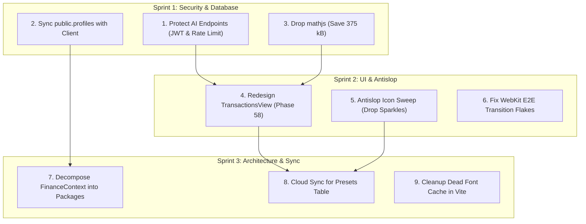

# FinLife Tracker: Architecture, Security, and Codebase Audit
**Date:** September 30, 2026  
**Auditor:** Antigravity AI  
**Scope:** Full Project Review (Architecture, Security, Database, UI/UX, Performance, Tests, Standards)  
**Deliverable File:** `AGY_AUDIT300926.md` (Root)

---

## 1. Executive Summary

FinLife Tracker is a full-stack personal finance and holistic lifestyle Progressive Web App (PWA) built with **React 19**, **TypeScript 5.8**, **Vite 6**, **Tailwind CSS v4**, and **Supabase**. The application tracks Thai Baht (THB) accounts, transactions, debt repayment trajectories, and daily wellness logs (mood, workouts, nutrition).

### Overall Health & Strengths
- **Engineering Discipline**: Exceptional documentation through 30 Architecture Decision Records (ADRs `0001` to `0030`), refactor logs, and rigorous commit trails.
- **Financial Integrity**: Strict single-currency constraint (`THB` only), relative atomic RPCs on Supabase (`record_transaction`, `transfer_funds`, `set_transaction_deleted`), and client-side idempotency keys.
- **Date Correctness**: Consistent local calendar day comparisons (`todayIsoDate`, `toIsoDate` at UTC+7) avoiding UTC date shift pitfalls.
- **Test Automation**: Robust test suite with **385 passing unit tests** across 20 Vitest test suites and **119 Playwright E2E tests** (357 browser runs across Chromium, Firefox, WebKit).
- **Design Tokens**: Successful foundation redesign (Phase 55 to 57) introducing semantic design tokens, WCAG 2.1 AA token verification, self-hosted IBM Plex Sans Thai with tabular figures, and an updated Dashboard.

### Primary Risk Vectors Identified
Despite these strengths, this deep-dive audit identified 12 actionable findings categorized into four risk tiers:
1. **Critical Risk (2 items)**: Publicly exposed, unauthenticated serverless AI proxy endpoints draining TypeSafe API credits; database schema desynchronization between Supabase `public.profiles` and frontend client state.
2. **High Risk (3 items)**: Monolithic 3,285-line `FinanceContext.tsx` coupling all domain logic; 5 of 6 views remaining on legacy unmigrated UI primitives; multi-device data loss for transaction presets.
3. **Medium Risk (4 items)**: `mathjs` vendor bloat adding 375 kB (110 kB gzip) for basic arithmetic; `Sparkles` icon remaining in 4 components in violation of antislop rules; lack of DOM virtualization for expanding ledgers; intermittent Playwright E2E timeouts on WebKit transitions.
4. **Low / Informational Risk (3 items)**: Dead Google Fonts cache configuration in Workbox PWA manifest; eager date helpers inflating entry bundle; minor documentation synchronization gaps.

---

## 2. Methodology & Verification Diagnostics

The findings in this report were verified through direct codebase analysis, schema introspection via Supabase MCP, and local test executions:

| Diagnostic Gate | Tool / Command | Result | Evidence / Details |
| :--- | :--- | :---: | :--- |
| **Type Check** | `npm run lint` | **PASS** | `tsc --noEmit` and `tsc -p api/tsconfig.json` exited with 0 errors. |
| **Unit Test Suite** | `npm run test:unit` | **PASS** | **385/385 passed** across 20 test files in 68.98s (Vitest v5.0.1). |
| **Production Build** | `npm run build` | **PASS** | Built in 25.39s; 55 PWA precache assets (1,619.34 KiB total). |
| **Database Schema** | Supabase MCP (`list_tables`, `execute_sql`) | **VERIFIED** | Active project `Income-Expense-db` (`rmpnzlcufeioxmgoocpt`), 7 public tables checked. |
| **WCAG Token Contrast** | `node scripts/wcag-tokens.mjs` | **PASS** | All token pairs pass WCAG AA in both light and dark themes. |
| **Anti-Slop Compliance** | Antislop Rules Scan (R-01 to R-38) | **MIXED** | Zero em dashes in source; 4 components still violate R-04 (`Sparkles`). |

---

## 3. Prioritized Improvement Suggestions by Risk Level

```
┌─────────────────────────────────────────────────────────────┐
│                     RISK LEVEL OVERVIEW                     │
├───────────────────┬─────────────────────────────────────────┤
│ 🔴 CRITICAL (2)   │ Security & Auth Flaws, Data Drift       │
│ 🟠 HIGH (3)       │ Architecture Bloat, Incomplete Redesign │
│ 🟡 MEDIUM (4)     │ Bundle Bloat, UX/Antislop, E2E Flakes   │
│ 🟢 LOW (3)        │ Dead Config, Hygiene, Documentation     │
└───────────────────┴─────────────────────────────────────────┘
```

---

### 🔴 CRITICAL RISK

#### Finding 1: Unprotected Public AI Proxy Endpoints (Credit Drainage & DDoS Vulnerability)
- **Files Affected**: `api/classify.ts` (lines 149-215) and `api/insights.ts` (lines 125-185)
- **Problem**:
  Both serverless functions export HTTP `POST` handlers that call `https://api.typesafe.ai/v1/systemone` using the server environment variable `TYPESAFE_API_KEY`. While the handlers validate input bounds (text length, category count) and forbid client-supplied prompts (blocking prompt injection), **neither endpoint performs user authentication or rate limiting**:
  1. No check is made for a Supabase authorization header (`Authorization: Bearer <jwt>`).
  2. No session or caller validation exists.
  3. No IP-level rate-limiting is configured.
- **Risk**: Any automated script or malicious actor on the internet can discover these endpoints and send repeated requests, burning through the project's TypeSafe AI API budget or triggering upstream 429 locks for legitimate app users.
- **Remediation Steps**:
  1. Require an `Authorization` header containing the user's Supabase JWT on all incoming requests to `/api/classify` and `/api/insights`.
  2. Verify the JWT server-side via Supabase client:
     ```typescript
     const authHeader = req.headers.get('Authorization');
     if (!authHeader?.startsWith('Bearer ')) {
       return json({ error: 'Unauthorized: missing access token.' }, 401);
     }
     const token = authHeader.slice(7);
     const { data: { user }, error } = await supabase.auth.getUser(token);
     if (error || !user) {
       return json({ error: 'Unauthorized: invalid session.' }, 401);
     }
     ```
  3. Enforce IP-based or user-based rate limiting (e.g. max 30 classifications per minute per user).

---

#### Finding 2: Database Schema & Client State Desynchronization (`public.profiles`)
- **Files Affected**: Database table `public.profiles` vs `src/context/FinanceContext.tsx` (lines 1036-1065) and `src/components/account/AccountModal.tsx` (line 348)
- **Problem**:
  The Supabase database has a dedicated `public.profiles` table with:
  - `id uuid primary key references auth.users(id)`
  - `email text not null`
  - `name text default 'User'`
  - `role text check (role in ('USER', 'ADMIN')) default 'USER'`
  - `created_at timestamptz default now()`
  - Explicit RLS policies for viewing and updating (`auth.uid() = id`).
  - An active database trigger `handle_new_user()` populating it on sign-up.

  However, **the client application completely ignores this table**:
  1. In `FinanceContext.tsx`, `currentUser` is synthesized solely from `supabase.auth.getSession()` and `session.user.user_metadata`, hardcoding `role: 'USER'`.
  2. In `AccountModal.tsx`, editing the display name invokes `supabase.auth.updateUser({ data: { name } })`, which modifies `auth.users.raw_user_meta_data` but **never** updates `public.profiles.name`.
  3. There is no query to `.from('profiles')` anywhere in the frontend.
- **Risk**: Severe data drift between the database and application state. Role-based privileges (`ADMIN` vs `USER`) in the database are unreadable by the client, and external admin tools or queries inspecting `public.profiles` see stale or missing names.
- **Remediation Steps**:
  1. Add a profile fetch to `loadSupabaseData`:
     ```typescript
     const { data: profile } = await supabase.from('profiles').select('*').eq('id', userId).single();
     ```
  2. In `AccountModal.tsx`, update both `auth.users` and `public.profiles` atomically or through a database trigger that propagates metadata changes.
  3. Extract profile management into a deep module (`src/packages/profile/`) following `ts-patterns` rules.

---

### 🟠 HIGH RISK

#### Finding 3: Monolithic State Container in `FinanceContext.tsx` (3,285 LOC)
- **Files Affected**: `src/context/FinanceContext.tsx`
- **Problem**:
  Despite splitting into `FinanceStateContext` and `FinanceActionsContext` and using ref mirrors to stabilize mutator callbacks, `FinanceContext.tsx` remains a **3,285-line monolith**. It bundles:
  - Authentication lifecycle and session device revocation
  - LocalStorage debounced batch writer (`pendingWritesRef`)
  - Cloud synchronization and Supabase realtime multiplexing
  - Wallets state, balance mutations, and optimistic rollback
  - Categories and keyword rule dictionaries
  - Transactions ledger, soft-deletion, and idempotency guards
  - Debts state, interest tracking, and repayment reconciliation
  - Daily diary entries and wellness correlation
  - Quick presets / transaction templates
  - Bulk CSV import parsing and dry-run commit
- **Risk**:
  1. High cognitive load and elevated regression risk during feature additions.
  2. Difficult to test domain logic in true isolation without spinning up the entire context harness.
  3. Violates Single Responsibility and Deep Module design patterns (`ts-patterns`).
- **Remediation Steps**:
  1. Progressively decompose `FinanceContext.tsx` into domain packages under `src/packages/`:
     - `src/packages/ledger/` (transactions, idempotency, relative RPC mutations)
     - `src/packages/wallets/` (wallets CRUD, balance tracking)
     - `src/packages/debts/` (debt goals, interest, repayment plan)
     - `src/packages/diary/` (wellness logs, mood correlation)
     - `src/packages/categories/` (categories, keyword rules, suggestions)
  2. Retain `FinanceContext` purely as a top-level root coordinator that wires domain packages together.

---

#### Finding 4: Incomplete Redesign Migration (5 of 6 Main Views on Legacy UI)
- **Files Affected**:
  - `src/views/TransactionsView.tsx` (902 LOC)
  - `src/views/WalletsView.tsx` (193 LOC)
  - `src/views/DebtsView.tsx` (318 LOC)
  - `src/views/DiaryView.tsx` (416 LOC)
  - `src/views/CategoriesView.tsx` (664 LOC)
- **Problem**:
  Phase 57 successfully redesigned `DashboardView.tsx` according to `docs/design/finlife-redesign-spec.md` (spec section 6.1) and ADR `0030`. However, the remaining five views have not been migrated to the redesign specification (spec section 9, step 4):
  - `TransactionsView` still uses the old `SectionHeader` and the heavy `TransactionTableRow` table layout instead of the new `PageHeader`, `TransactionRow`, and `DayGroupHeader` (L11 day grouping).
  - `WalletsView`, `DebtsView`, `DiaryView`, and `CategoriesView` still import `SectionHeader` and use pre-redesign card layouts.
  - Legacy button styling and inline color tokens persist in unmigrated views.
- **Risk**: Visual inconsistency across application tabs, fragmented user experience, and ongoing maintenance burden of dual component sets (`SectionHeader` vs `PageHeader`, `TransactionTableRow` vs `TransactionRow`).
- **Remediation Steps**:
  1. Schedule Phase 58: Migrate `TransactionsView.tsx` (designated as highest priority in the redesign specification). Adopt `PageHeader`, `TransactionRow`, and `DayGroupHeader`.
  2. Schedule Phase 59: Migrate `WalletsView.tsx` and `DebtsView.tsx`.
  3. Schedule Phase 60: Migrate `DiaryView.tsx` and `CategoriesView.tsx`.
  4. Retire `SectionHeader.tsx` and `TransactionTableRow.tsx` once migration is complete.

---

#### Finding 5: Multi-Device Data Loss for Transaction Presets (`pf_presets`)
- **Files Affected**: `src/context/FinanceContext.tsx` (lines 497-501), `src/types.ts` (lines 94-104), and `HANDOFF.md` (lines 78-79)
- **Problem**:
  Transaction presets / templates (`Preset[]`) are stored only in client browser `localStorage` under key `pf_presets`. While documented in `HANDOFF.md` as "personal configuration shortcuts, not shared ledger data":
  1. When an authenticated user signs out, `resetToGuestState()` wipes `localStorage` completely (verified in `authenticated-ledger.test.tsx`), destroying all user-created presets.
  2. Presets do not synchronize between desktop and mobile devices. A user configuring quick-add presets on desktop has zero presets on mobile.
- **Risk**: Frequent user frustration due to unexpected loss of customized templates upon sign-out, browser data clearing, or switching devices.
- **Remediation Steps**:
  1. Create a Supabase migration adding table `public.presets`:
     ```sql
     create table public.presets (
       id uuid primary key default gen_random_uuid(),
       user_id uuid references auth.users(id) on delete cascade not null,
       name text not null,
       type text not null check (type in ('INCOME', 'EXPENSE')),
       amount numeric not null,
       description text not null,
       category_id uuid references public.categories(id) on delete set null,
       wallet_id uuid references public.wallets(id) on delete set null,
       created_at timestamptz default now()
     );
     alter table public.presets enable row level security;
     create policy "Users manage own presets" on public.presets
       for all using (auth.uid() = user_id) with check (auth.uid() = user_id);
     ```
  2. Include `presets` in `FinanceContext` cloud synchronization when `isAuthenticated` is true, maintaining local fallback for guest mode.

---

### 🟡 MEDIUM RISK

#### Finding 6: Massive Math.js Vendor Bundle Overhead (375 kB Raw / 110 kB Gzip)
- **Files Affected**: `src/utils/mathEvaluator.ts` (line 1), `package.json` (line 20), and `vite.config.ts` (chunking)
- **Problem**:
  In `src/utils/mathEvaluator.ts`, the application imports `{ evaluate } from 'mathjs/number'` to evaluate inline arithmetic expressions entered by the user in `InlineMathInput` (e.g. `120+45*2`).
  In the production build:
  - `dist/assets/vendor-math-D9WQvjt3.js` measures **375.73 kB** (**110.72 kB gzip**).
  - This is the **largest single vendor chunk** in the entire application, exceeding `@supabase/supabase-js` (226 kB), `react`/`react-dom` (194 kB), and `framer-motion` (129 kB).
  - This 375 kB chunk is precached into the Service Worker cache on every install.
- **Risk**: Significant bundle bloat, increased initial download footprint, and parse latency on mobile devices for a feature that only evaluates basic arithmetic operators (`+`, `-`, `*`, `/`, `()`, `%`).
- **Remediation Steps**:
  1. Replace `mathjs` with a lightweight, zero-dependency math expression evaluator (~80 lines of TypeScript implementing a shunting-yard or recursive-descent parser).
  2. Verify precision with existing `date-format.test.ts` / math tests.
  3. Uninstall `mathjs` and remove the `vendor-math` chunk from `vite.config.ts`.
  4. Benefit: Shrinks the PWA precache footprint by ~23% immediately.

---

#### Finding 7: Antislop Rule Violations (R-04: Sparkles Glyphs in 4 Components)
- **Files Affected**:
  - `src/components/InlineMathInput.tsx` (lines 2, 202)
  - `src/components/TransactionForm.tsx` (lines 3, 891, 953)
  - `src/views/CategoriesView.tsx` (lines 7, 449)
  - `src/views/TransactionsView.tsx` (lines 11, 721, 830, 842)
- **Problem**:
  While Phase 57 audit 005 (finding 1) replaced `Sparkles` on the Dashboard's `SpendingInsightsCard` with `ChartLine`, the `Sparkles` icon remains imported and rendered at multiple locations across 4 other files.
  Per [`antislop/SKILL.md`](file:///C:/Users/MRmar/.gemini/config/skills/antislop/SKILL.md) Rule **R-04 (Icons)**:
  > "FORBIDDEN as default without purpose: Sparkle, Star, Magic, Lightning, Diamond, Orb, Robot as feature icons... Icons must be genuinely relevant to the content they represent."
- **Risk**: Violates project antislop standards and degrades the crafted, non-AI aesthetic of the application.
- **Remediation Steps**:
  1. `InlineMathInput.tsx:202`: Replace `Sparkles` with `Calculator` or `Equal`.
  2. `TransactionForm.tsx:891,953`: Replace `Sparkles` on suggestion chips with `Tag` or `Lightbulb`.
  3. `CategoriesView.tsx:449`: Replace `Sparkles` on Quick-Input test with `Play` or `Zap` (or a focused label icon).
  4. `TransactionsView.tsx:721,830,842`: Replace `Sparkles` on CSV auto-classify with `CheckCheck` or `Tag`.

---

#### Finding 8: Lack of DOM Virtualization for Growing Transaction Ledgers
- **Files Affected**: `src/views/TransactionsView.tsx` (lines 105-107, 860-890)
- **Problem**:
  `TransactionsView` currently implements pagination with `pageSize = 8`. However:
  1. All non-deleted transactions for the user are loaded into memory (`rawTransactions`) and filtered in-memory.
  2. In the CSV import modal, while preview rows are capped at 100 in the DOM, processing files with hundreds of rows can cause rendering stutters.
  3. On mobile devices, paging through 8 items at a time is cumbersome compared to a smooth virtualized feed.
- **Risk**: As active users accumulate hundreds or thousands of transactions, memory usage and filter recomputations will degrade mobile browser responsiveness.
- **Remediation Steps**:
  1. Introduce `@tanstack/react-virtual` for virtualized rendering of long transaction lists.
  2. Implement cursor-based pagination or date-window querying against Supabase for ledgers exceeding 500 rows.

---

#### Finding 9: Intermittent Playwright E2E Timeouts on WebKit / Firefox
- **Files Affected**: `tests/` specs (`tests/csv-classify.spec.ts`, `tests/insights.spec.ts`, `tests/categories.spec.ts`)
- **Problem**:
  Documented in `anti-slop/audit-005-2026-09-28.md` (finding 3) and `refactor-log.md`: in full local Playwright test runs, occasional timeouts occur (e.g. 353-356 passed out of 357). Failures are concentrated in WebKit and Firefox waiting for actionability/stability on elements like `#tx-import-csv-btn` during view slide transitions.
- **Risk**: Intermittent test failures cause developer friction, slow down PR merges, and risk masking real regressions.
- **Remediation Steps**:
  1. Disable Framer Motion page transitions during E2E test runs (e.g., via CSS `@media (prefers-reduced-motion: reduce)` or `data-test-mode` attribute on `<body>`).
  2. Replace arbitrary locator waits with deterministic state assertions (e.g. asserting `aria-busy="false"` or waiting for the view container to be visible).

---

### 🟢 LOW / INFORMATIONAL RISK

#### Finding 10: Dead Google Fonts Cache Configuration in `vite.config.ts`
- **Files Affected**: `vite.config.ts` (lines 60-89)
- **Problem**:
  `vite.config.ts` configures Workbox `runtimeCaching` for `fonts.googleapis.com` and `fonts.gstatic.com`. However, under ADR `0027`, Google Fonts were eliminated in favor of self-hosting `@fontsource/ibm-plex-sans-thai`. The app makes zero external font requests.
- **Risk**: Harmless dead configuration that creates confusion for future developers.
- **Remediation Steps**:
  Remove the `fonts.googleapis.com` and `fonts.gstatic.com` runtime caching entries from `vite.config.ts`.

---

#### Finding 11: Eager Date Formatters Bloating Entry Bundle
- **Files Affected**: `src/utils/date.ts`
- **Problem**:
  `src/utils/date.ts` is imported eagerly by `FinanceContext.tsx` on initial boot. In Phase 57, several view-specific formatting helpers (`formatLongDate`, `formatShortDate`, `formatWeekdayDate`, `formatMonthName`, `greetingFor`) were appended to `date.ts`. Because the module is already in the main bundle, all formatting code lands in the initial JS chunk rather than being split with the lazy views.
- **Risk**: Minor initial bundle inflation (+1.39 kB).
- **Remediation Steps**:
  Separate `src/utils/date.ts` into:
  - `src/utils/dateCore.ts`: Eager ISO date computations (`todayIsoDate`, `toIsoDate`, `daysAgoIsoDate`).
  - `src/utils/dateDisplay.ts`: User-facing formatting strings (`formatLongDate`, `greetingFor`, etc.) imported only by the views that render them.

---

#### Finding 12: Stale Task Ledger Documentation
- **Files Affected**: `docs/audit/task-ledger.md` and `HANDOFF.md`
- **Problem**:
  `task-ledger.md` was last updated through Phase 48 (T129-T135) on Sept 24, 2026. Phases 49 through 57 (up to Sept 28, 2026) are fully recorded in `docs/audit/refactor-log.md` and ADRs, but their individual task rows were not backfilled into `task-ledger.md`.
- **Risk**: Discrepancy between documentation files when auditing task history.
- **Remediation Steps**:
  Backfill the summary rows for Phases 49-57 into `docs/audit/task-ledger.md` during the next documentation pass.

---

## 4. Implementation Roadmap & Recommended Sequence



### Action Priority Matrix
1. **Week 1 (Immediate - Security & Performance)**:
   - Add Supabase JWT authentication to `/api/classify` and `/api/insights` (Finding 1).
   - Wire `public.profiles` to frontend profile state and update operations (Finding 2).
   - Replace `mathjs` with native lightweight arithmetic evaluator (Finding 6).
2. **Week 2 (Redesign & Antislop)**:
   - Implement Phase 58: Redesign `TransactionsView.tsx` with `PageHeader`, `TransactionRow`, and `DayGroupHeader` (Finding 4).
   - Replace remaining `Sparkles` glyphs with semantic icons (Finding 7).
   - Disable animations during E2E testing to eliminate WebKit flakes (Finding 9).
3. **Week 3 (Architecture & Multi-Device Sync)**:
   - Add Supabase `presets` table and sync logic (Finding 5).
   - Begin decomposing `FinanceContext.tsx` into `src/packages/` deep modules (Finding 3).
   - Remove dead Workbox Google Fonts caching rules (Finding 10).

---

## 5. UI and UX Deep-Dive Review

### 5.1 Design System and Aesthetic Cohesion

The design system established in `DESIGN.md` and refined through Phases 55-57 represents a high level of craftsmanship. The aesthetic direction (`ENERGY 2 / RHYTHM 1 / MOTION 1`) provides a calm, functional, tool-focused atmosphere rather than an over-decorated showcase.

#### Key Strengths:
1. **Semantic Color Assignment**: Hues carry strict meaning rather than decorative intent. Green is reserved for `income`, red for `expense` and debt owed, blue for internal `transfer`, grey for neutral adjustments and repayments (`adjust`), violet for interactive brand actions (`brand`), and amber for genuine alerts (`pending`).
2. **Typography and Numbers**: Self-hosting `IBM Plex Sans Thai` ensures consistent Latin and Thai character rendering, including the baht symbol (`฿`) and minus (`−` U+2212). The use of tabular figures (`font-variant-numeric: tabular-nums`) without a second monospace font ensures numerical columns align cleanly.
3. **Contrast and Theme Switching**: All token pairs pass WCAG 2.1 AA requirements across both dark and light modes, verified through `scripts/wcag-tokens.mjs`. The primary CTA button achieves a 5.70:1 contrast ratio.

#### UI/UX Inconsistencies & Friction Points:
1. **Identity Palette Drift in User Content**: While system colors are tightly locked, user-created categories and wallets still use an older raw hex palette (`#f87171`, `#fb923c`, etc.) in `CategoriesView.tsx:59-62`, conflicting with the muted identity palette defined in section 1 of the redesign spec.
2. **Card Elevation vs Inset Surfaces**: In `surface-1` (card) and `surface-2` (inset) nestings, certain unmigrated cards in `DebtsView` and `WalletsView` lack visual separation in light mode due to subtle 1px border contrasts against white canvas.

---

### 5.2 Navigation and Information Architecture

Navigation is split into two purpose-built viewports:
- **Desktop (>= 768px)**: A clean 64px single-row header (`src/components/Navbar.tsx`) housing brand, 6 horizontal nav tabs, sync indicator badge, theme toggle, and account pill.
- **Mobile (< 768px)**: A 5-slot thumb-friendly bottom bar (`src/components/MobileBottomNav.tsx`) with Home, Txns, central Quick Add button, Wallets, and a "More" drawer bottom sheet.

#### UX Evaluation:
1. **Mobile Bottom Nav Ergonomics**:
   - The central elevated Quick Add button with `shadow-quick-add` glow serves as the primary focal point, allowing one-tap logging from any tab.
   - The 5-slot structure (ADR 0024) successfully eliminated the cramped 7-tab layout that suffered from 9px illegible labels.
2. **Touch Swipe Transitions**:
   - Swiping horizontally switches tabs using `react-swipeable` and Framer Motion 200ms easeOut tweens.
   - The swipe guard (`src/utils/swipeGuard.ts`) prevents accidental tab changes when interacting with horizontally scrollable elements (e.g. wide tables or chip trays).
3. **Information Scent in "More" Drawer**:
   - Housing Debt Payoff, Daily Diary, Categories, and Account & Security within the "More" bottom sheet is clean, but users tracking daily habits (diary) must make two taps to reach their daily log. A customizable bottom nav slot (pinning Diary over Wallets) would improve daily retention.

---

### 5.3 View-by-View Interaction and Layout Analysis

#### 1. Dashboard View (`src/views/DashboardView.tsx`)
- **Status**: Redesigned to Spec 6.1 (Phase 57).
- **Pros**: Clear visual hierarchy led by the Net Worth hero figure. The Cash Flow card contextualizes income vs spending over 30 days. The debt warning banner triggers only when L5 criteria fire (debt needs exceeding monthly surplus).
- **UX Gaps**:
  - **Non-Interactive Recent Activity**: `RecentActivityCard.tsx` renders `TransactionRow` elements without an `onSelect` handler. Clicking a row does nothing, confounding user expectations that a transaction row can be viewed or edited.
  - **Card Height Asymmetry on Desktop**: At 1280px, cards in the same grid row take `h-full`. If the user has few categories, `CategorySpendingCard` stretches with a large empty lower area beside `DebtPayoffCard`.
  - **Scope of Period Filter**: The period control (`7D`, `30D`, `90D`, `YTD`, `ALL`) visually floats above the dashboard, but only filters Cash Flow and Category spending. Net worth and Wallets remain lifetime aggregates. Adding a clear scope indicator ("Showing cash flow for...") avoids confusion.

#### 2. Transactions View (`src/views/TransactionsView.tsx`)
- **Status**: Legacy layout (pre-redesign).
- **Pros**: Robust filtering by wallet, transaction type, and debounced text search. CSV import includes validation preview and batch auto-classification.
- **UX Gaps**:
  - **Desktop Table on Mobile**: Uses a desktop HTML `<table>` via `TransactionTableRow.tsx`. On mobile viewports (390px), columns get squeezed, and long descriptions truncate aggressively or force horizontal overflow.
  - **Rigid 8-Item Pagination**: The pagination controls (`currentPage`, `pageSize = 8`) require repetitive clicking for active users. Replacing this with date-grouped sections (`DayGroupHeader`) and virtualized scrolling aligns with mobile design best practices.
  - **CSV Error Discoverability**: When a CSV file contains invalid rows, the error banner notes the count (e.g. "3 invalid rows"), but finding which rows failed in a 100-row preview requires horizontal scanning across all columns.

#### 3. Wallets & Accounts View (`src/views/WalletsView.tsx`)
- **Status**: Legacy layout.
- **Pros**: Clear card presentation with wallet icons, balances, and quick transfer buttons. Destructive actions are guarded by `ConfirmDialog`.
- **UX Gaps**:
  - **Balance Adjustment Friction**: Correcting a wallet balance requires opening `WalletPopupModal`, navigating to the balance tab, and submitting. A quick inline "Reconcile Balance" action directly on the card would streamline daily banking checks.
  - **Visual Redundancy**: Both the main page and the popup modal repeat identical wallet statistics in slightly different arrangements.

#### 4. Debt Payoff View (`src/views/DebtsView.tsx`)
- **Status**: Legacy layout.
- **Pros**: Progress bars clearly visualize remaining balance vs total debt. Settling and deleting debts are properly confirmed.
- **UX Gaps**:
  - **Lack of Motivation / Projection UI**: While interest rate and minimum payment are stored, the view provides no amortization projection (e.g. "At this rate, debt-free by March 2027"). Showing projected interest savings when making extra repayments transforms a ledger into a motivational tool.
  - **Repayment Form Embedding**: Clicking "Repay" opens a modal containing the full `TransactionForm` with preset fields. While functionally solid, the modal feels cluttered compared to a dedicated quick-repay slider or number pad.

#### 5. Daily Diary View (`src/views/DiaryView.tsx`)
- **Status**: Legacy layout.
- **Pros**: Integrates emotional wellness and physical habits with financial behavior. Clean day view linking daily outflow to mood.
- **UX Gaps**:
  - **System Emojis for Mood**: Uses native emoji characters (`😫`, `😕`, `😐`, `😊`, `🤩`). On Windows, system emojis render as flat thick-bordered glyphs that clash with Tailwind design tokens. Custom monochrome or subtle SVG face icons provide a more polished, platform-agnostic look.
  - **Date Navigation Ergonomics**: Switching days requires typing an ISO string or clicking "Today" / "Yesterday". A horizontal swipeable week calendar strip would significantly enhance daily logging speed.
  - **Correlation Synthesis**: The data connects mood to spending, but never surfaces insights back to the user (e.g. "You spend an average of ฿850 more on low-energy days").

#### 6. Categories & Smart Rules View (`src/views/CategoriesView.tsx`)
- **Status**: Legacy layout.
- **Pros**: Combines category taxonomy with smart keyword-matching sandbox. Users can test description strings against rules before saving.
- **UX Gaps**:
  - **Raw Enum Exposure**: Displays raw uppercase strings in parts of the UI.
  - **Orphan Prevention**: When deleting a category that has associated transactions, the system blocks deletion. However, it does not offer a "Reassign transactions to another category" flow, forcing users to manually reclassify past transactions one by one.

---

### 5.4 Forms, Modals, and Input Ergonomics

#### 1. Express Input Note Parsing (`src/utils/expressInput.ts`)
- **Highlights**: One of the strongest UX features in the application. Users can type naturally in Thai or English ("ข้าวมันไก่ 60", "bts 45", "1200 ค่าไฟ"), and the form automatically extracts the amount, strips it from the note, and triggers category prediction.
- **Improvement**: Users are often unaware this feature exists because the placeholder reads "e.g. Lunch with colleagues". Adding an explicit subtitle or dynamic chip example ("Tip: Type 'Lunch 60' to auto-fill amount") increases feature adoption.

#### 2. Inline Math Input (`src/components/InlineMathInput.tsx`)
- **Highlights**: Allows real-time arithmetic calculation inside the amount input field (`500+500` or `1200*0.8`). Includes quick operator increment chips (`+10`, `+50`, `+100`, `+500`).
- **Improvement**: On iOS Safari and Android Chrome, the `<input>` type defaults to text, which opens the full alphanumeric keyboard rather than the numeric pad. Using `inputMode="decimal"` or a custom mini-calculator numpad on mobile dramatically reduces input friction.

#### 3. Quick Add Modal (`src/components/QuickAddModal.tsx`)
- **Highlights**: Opens instantly via deferred mounting latch (ADR 0010). Features one-tap preset chips at the top for logging recurring expenses with zero keystrokes.

---

### 5.5 Accessibility, Touch Targets, and Motion Standards

#### 1. Tap Targets and Touch Ergonomics
- The project strictly adheres to the 44px minimum touch target rule across all interactive swatches, pills, buttons, and close crosses (`min-h-[44px]` or negative-margin wrappers).
- Buttons use the dedicated `Button` and `IconButton` primitives (`src/components/ui/Button.tsx`) with accessible names (`aria-label` and `title`).

#### 2. Keyboard Navigation and Focus Rings
- A global `:focus-visible` outline in violet (`ring-focus`, 2px with 2px offset) is declared in `src/index.css` and verified in both themes.
- Modals support Escape key closure and trap focus cleanly.
- Dialog backdrops use solid opaque scrims (`bg-scrim`) rather than heavy blur, maintaining contrast and readability.

#### 3. Motion and Transition Discipline
- Motion follows `DESIGN.md MOTION 1`: durations are capped between 150ms and 200ms using `easeOut` curves.
- Audit finding 2 from Phase 56 replaced `transition-colors` with `@utility transition-control` across 22 files, preventing the violet focus ring from fading in from the text color.
- No continuous looping animations or distracting hover scales are used.

---

### 5.6 Prioritized UI/UX Recommendations & Action Plan

| Priority | Area | Proposed Improvement | Expected User Benefit |
| :---: | :--- | :--- | :--- |
| **P1** | **Transactions View** | Execute Phase 58: Replace `<table>` with `TransactionRow` and `DayGroupHeader`. | Eliminates mobile pinch/overflow; improves scanning speed on all screen sizes. |
| **P2** | **Dashboard View** | Make `RecentActivityCard` rows clickable to open transaction details/editor. | Resolves dead-click expectation and allows quick corrections directly from home. |
| **P3** | **Input Ergonomics** | Add `inputMode="decimal"` and a mobile-friendly keypad for `InlineMathInput`. | Eliminates keyboard switching hassle on iOS and Android devices. |
| **P4** | **Diary View** | Add horizontal week-strip day picker and replace raw system emoji with themed SVG icons. | Faster daily check-ins; consistent, professional aesthetic across platforms. |
| **P5** | **Debt Payoff** | Display projected debt-free dates and interest savings on extra repayments. | Shifts the debt view from passive ledger to active motivational payoff tool. |
| **P6** | **Categories View** | Implement "Reassign & Delete" modal when deleting an active category. | Removes roadblock when reorganizing personal expense categories. |

---
*Audit completed on September 30, 2026. Written directly to `AGY_AUDIT300926.md` at repository root.*
